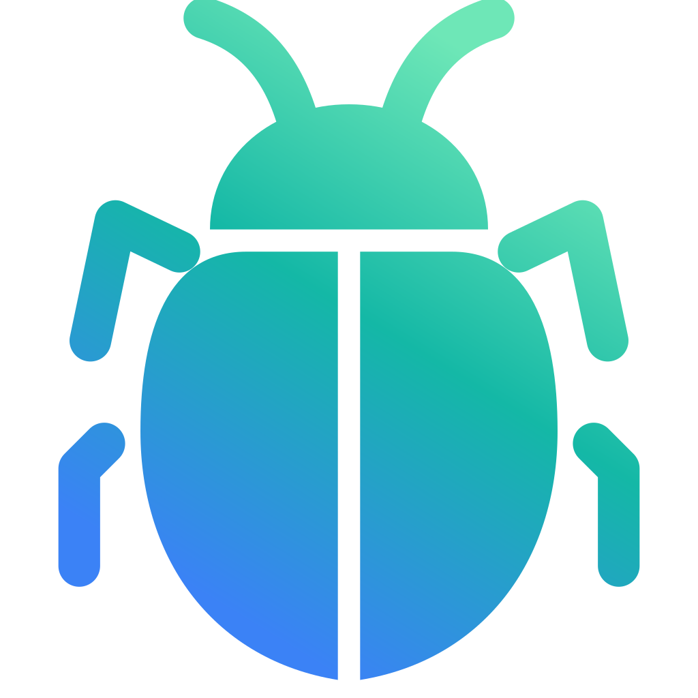

#  Brouk

*Brouk* (Czech for "beetle") is a lightweight, fully configurable, multiplatform web browser based on Chromium (via CEF), focused on work.

**Status:** beta, for macOS (Apple Silicon and Intel) and Windows 10 and 11 (x64).

## Download

Builds are on the [releases page](https://github.com/DreaddCZ/brouk-releases/releases): disk images for macOS (signed and notarized by Apple) and an installer for Windows (not code-signed, see [Code signing](#code-signing)). Brouk then updates itself.

## Documentation

- What Brouk can do, and why: [`docs/pitch/why-brouk.md`](docs/pitch/why-brouk.md)
- User help: [`web/help/content/`](web/help/content/) (in the app: Help menu)
- Building: [`docs/building.md`](docs/building.md)
- Requirements and features: [`specs/`](specs/README.md)
- Guidance for Claude Code, and the project's coding rules: [`CLAUDE.md`](CLAUDE.md)

## Code signing

macOS releases are signed with the maintainer's Apple Developer ID and notarized by Apple. The Windows installer is not code-signed, so Windows SmartScreen warns about an unknown publisher (More info → Run anyway). Updates on both systems are checked against Brouk's own signing key (Ed25519) before they are installed.

## Privacy

Brouk collects no data about you and sends no telemetry. Apart from the pages you open, it connects to the internet only for these features, each of which can be turned off in Settings:

- **Updates:** downloads the update feed from GitHub Pages and new versions from GitHub. Nothing about you or your device is sent.
- **Ad blocking:** downloads the filter lists you have chosen from their publishers.
- **Breach check of saved passwords:** sends the first 5 characters of a password's SHA-1 hash to [Have I Been Pwned](https://haveibeenpwned.com/Passwords) (k-anonymity). The password itself never leaves your device.
- **Search suggestions:** sends what you type in the address bar to the search engine you chose, as other browsers do.
- **Bitwarden:** if you connect a profile to Bitwarden, the official Bitwarden CLI talks to your Bitwarden server.

Your profiles, history, passwords and settings are stored only on your device.

## Contributing

Bug reports and ideas are welcome as [issues](https://github.com/DreaddCZ/brouk/issues). Pull requests are welcome after the change has been agreed in an issue; see [`CONTRIBUTING.md`](CONTRIBUTING.md).

Security problems: please report them privately, as described in [`SECURITY.md`](SECURITY.md).

## Licence

Brouk is free for anyone to use, change and share, for personal or work use, under the [Apache License 2.0](LICENSE). Third-party software it uses is listed in [`third_party/README.md`](third_party/README.md).
